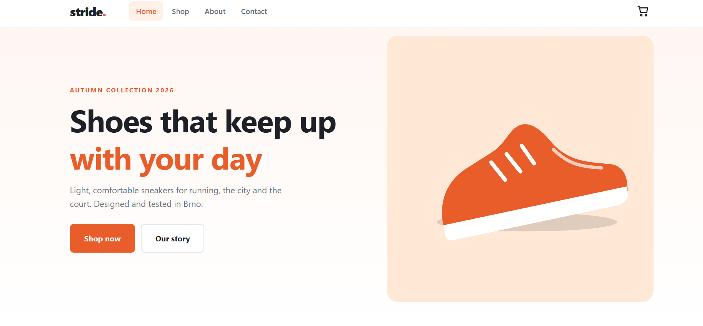
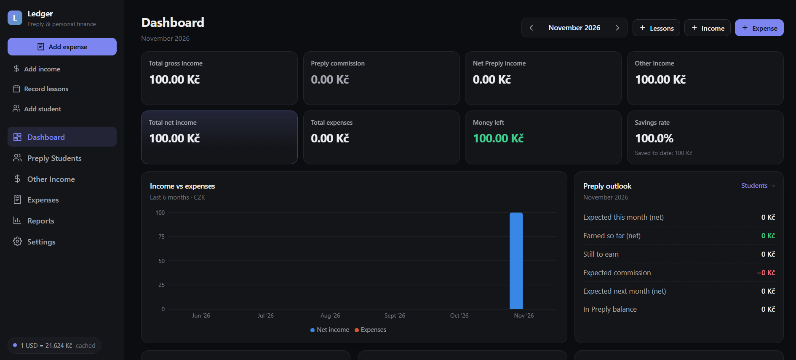

# Portfolio — Denys Melnyk

My personal portfolio website as a Junior Frontend Developer based in Brno, Czech Republic.

**Live site:** <https://denisproger.github.io/portfolio/>

## About

A single-page site with the following sections:

- **Home** — intro and availability for Junior / Trainee roles
- **About** — background, focus, and languages
- **Skills** — HTML5, CSS3, JavaScript, TypeScript, React, Git & GitHub
- **Projects** — selected work with links to code and live demos
- **Contact** — get in touch by email

## Featured projects

**[Stride Co. — Sneaker Shop](https://github.com/denisproger/product-page)**
A multi-page sneaker shop built with React, TypeScript, React Router and Vite: search, filters, product gallery, cart and checkout with form validation.
Live demo: <https://denisproger.github.io/product-page/>



**[Ledger — Preply & Personal Finance](https://github.com/denisproger/preply-finance)**
A finance tracker I use in my own tutoring work: students, lessons, Preply income and expenses, with automatic USD/EUR → CZK conversion.
Live demo: <https://denisproger.github.io/preply-finance/>



## Built with

- HTML5 (semantic markup)
- CSS3 (responsive layout, no frameworks)
- Vanilla JavaScript (mobile navigation menu, auto-updating footer year)
- [Inter](https://fonts.google.com/specimen/Inter) font from Google Fonts

## Project structure

```
portfolio/
├── index.html      # page markup
├── style.css       # styles
├── script.js       # mobile menu and footer year
├── favicon.svg     # site icon
└── images/
    ├── ledger.png  # Ledger preview
    └── stride.png  # Sneaker Shop preview
```

## Run locally

No build step needed. Clone the repository and open `index.html` in a browser:

```bash
git clone https://github.com/denisproger/portfolio.git
cd portfolio
```

## Contact

- Email: [denis.mel3841@gmail.com](mailto:denis.mel3841@gmail.com)
- GitHub: [@denisproger](https://github.com/denisproger)
- LinkedIn: [Denys Melnyk](https://www.linkedin.com/in/denys-melnyk-674832384)
